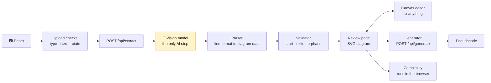

<p align="center">
  
</p>

<h1 align="center">Sketchpiler</h1>

<p align="center">
  <b>Draw a flowchart. Check it. Get code.</b><br>
  Turn a photo of a hand-drawn flowchart into a verified digital diagram,<br>
  deterministic pseudocode and a time and space complexity estimate.
</p>

<p align="center">
  
  
  
  
  
</p>

<p align="center">
  <a href="#why-sketchpiler-is-different">Why</a> ·
  <a href="#features">Features</a> ·
  <a href="#how-it-works">How it works</a> ·
  <a href="#quick-start">Quick start</a> ·
  <a href="#configuration">Configuration</a> ·
  <a href="#project-structure">Structure</a> ·
  <a href="#honest-limits">Limits</a>
</p>

---

## Why Sketchpiler is different

Most "photo to code" tools hand the whole job to an AI and hope for the best. Sketchpiler uses the AI for **one job only: reading the picture**. Everything after that is ordinary, testable code.

- **The AI runs once.** Parsing, validation, drawing, pseudocode and complexity are all deterministic. The same diagram always gives the same output.
- **A human confirms every box.** Handwriting is the weak point, so the editor is a core feature, not a fallback.
- **Structure is checked, not assumed.** A validator rejects diagrams with no start, decisions with a single exit, or boxes that nothing leads to.
- **Estimates show their reasoning.** The complexity card explains how it got its answer, and says "Couldn't determine" instead of guessing.

## Features

| | |
|---|---|
| **Flexible upload** | Choose, drag and drop, paste (Ctrl+V) or take a photo on a phone. Rotate before reading. Checks type and size (10 MB). |
| **Compact AI output** | The model answers in a short line format, not JSON, so a cut-off answer still keeps every complete line. |
| **Review page** | A clean SVG flowchart with a status line that lists the checks that passed, or exactly what failed. |
| **Canvas editor** | Drag boxes, draw arrows, marquee select, Select and Hand tools, align and distribute, snap to grid, undo and redo, auto layout, autosave. A simpler table editor is included. |
| **Pseudocode** | `INPUT`, `OUTPUT`, `WHILE ... END WHILE`, `IF ... ELSE ... END IF`, with a `GOTO` fallback for tangled flows. Copy it or download it as `.txt`. |
| **Complexity estimate** | Big-O time and auxiliary space, found by detecting loops and reading how their variables change. Runs in your browser. |
| **Providers** | Google Gemini, or any OpenAI-compatible endpoint (for example Groq or a local server). |
| **Themes** | Light, dark or follow the system, with a shared design system across every page. |

## How it works



The model is asked to output only lines like this:

```text
flowchart
N1 start "Start"
N2 proc "x = 1"
N3 end "End"
E N1 N2
E N2 N3
```

A trailing `~` marks handwriting the model could not read confidently. The parser turns these lines into nodes and arrows, the validator checks them, and from there no AI is involved.

### Example: the sum of 1 to n

A sketch with `Start`, `Input n`, `sum = 0, i = 1`, a decision `i <= n?`, a loop body `sum = sum + i; i = i + 1`, `Display sum` and `End` produces:

```text
INPUT n
sum = 0
i = 1
WHILE i <= n DO
  sum = sum + i
  i = i + 1
END WHILE
OUTPUT sum
```

The complexity card reports **time O(n)** and **space O(1)**, and lists the loop it found and the rule it applied.

## Screenshots

<table>
  <tr>
    <td align="center"><br><sub>Home</sub></td>
    <td align="center"><br><sub>Upload</sub></td>
  </tr>
  <tr>
    <td align="center"><br><sub>Review, pseudocode and complexity</sub></td>
    <td align="center"><br><sub>Canvas editor</sub></td>
  </tr>
</table>

## Quick start

**You need:** Node.js 20 or newer, and an API key for Gemini or for an OpenAI-compatible provider. Reading a photo needs a key. The recorded sample on the home page needs no photo and makes no AI call.

```bash
git clone <your-repo-url>
cd <project-folder>
npm install
cp .env.example .env      # then fill in your own values
npm run dev
```

Open <http://localhost:3000>. A health check is at <http://localhost:3000/api/health>.

> Keep `.env` private. It is listed in `.gitignore`, so it is never committed. Only `.env.example` (placeholders) belongs in the repository.

## Configuration

Set these in `.env`:

| Variable | Used when | Meaning |
|---|---|---|
| `PROVIDER` | always | `gemini` (default) or `openai_compat` |
| `PORT` | optional | Server port, default `3000` |
| `GEMINI_API_KEY` | `PROVIDER=gemini` | Your Gemini key |
| `GEMINI_MODEL` | `PROVIDER=gemini` | Gemini model name (needs to accept images) |
| `OPENAI_COMPAT_BASE_URL` | `PROVIDER=openai_compat` | Base URL of the endpoint |
| `OPENAI_COMPAT_API_KEY` | `PROVIDER=openai_compat` | Key for that endpoint |
| `OPENAI_COMPAT_MODEL` | `PROVIDER=openai_compat` | Model name (needs to accept images) |

If a needed variable is missing, the server stops at start-up and names the variable.

## Using Sketchpiler

1. **Upload** a photo of one flowchart. Straight-on photos in good light read best.
2. **Review** the digital diagram and the checks that passed.
3. **Edit** anything the model misread, then press **Done**.
4. **Generate pseudocode**, then read the time and space estimate underneath.

## Project structure

```text
src/                     Server and pipeline (TypeScript)
  server.ts              Entry point: loads config and starts Express
  app.ts                 Routes: /api/health, /api/extract, /api/generate
  config.ts              Environment loading with fail-fast checks
  image.ts               File-type check, downscale, re-encode
  prompt.ts              The instruction sent to the vision model
  pipeline.ts            Image -> provider -> parse -> validate
  parser.ts              Model's line format -> nodes and arrows
  validator.ts           Structural rules and confidence score
  generator.ts           Deterministic pseudocode generation
  providers/             ProviderAdapter + Gemini and OpenAI-compatible adapters
public/                  The web app (no build step)
  index.html             Home, Upload and Review views
  editor-canvas.html     Interactive canvas editor
  editor.html            Table editor
  styles.css             Design tokens, light and dark themes
  js/                    Pure logic: upload, diagram view, editor, complexity
tests/                   node:test suites and golden fixtures
scripts/                 Developer helpers (model list, smoke test)
docs/                    SPEC.md and the extraction prompt
```

For a guided tour, read the code in this order: `src/types.ts`, `src/prompt.ts`, `src/parser.ts`, `src/validator.ts`, `src/generator.ts`, `src/pipeline.ts`, `src/app.ts`, then the files in `public/js/`.

## Testing

```bash
npm test             # unit and integration tests
npm run typecheck    # TypeScript checks, no output files
```

The tests need no network and no API key. Golden fixtures (for example the sum-of-n diagram) pin the exact pseudocode, so any change to the generator's output is caught.

## Honest limits

- **Flowcharts only.** UML and ER diagrams are rejected on purpose.
- **Handwriting can be misread.** The confidence number measures *structure*, not whether the words were read correctly. That is why the editor exists.
- **One provider, one key.** It is chosen at start-up. There is no automatic failover yet.
- **The diagram lives in one browser tab** (`sessionStorage`). Closing the tab clears it. There is no database or account. Use **Download .txt** to keep the pseudocode.
- **Tangled flows** produce `GOTO` output instead of clean blocks.
- **Complexity is a heuristic.** It does not handle recursion, recurrences or amortised costs.

## Privacy

The photo is held in memory on the server and is not saved there. It is sent to the AI provider you configure, and that provider's own data rules apply. Only use providers you are comfortable sending your drawings to.

## License

No license has been chosen yet.